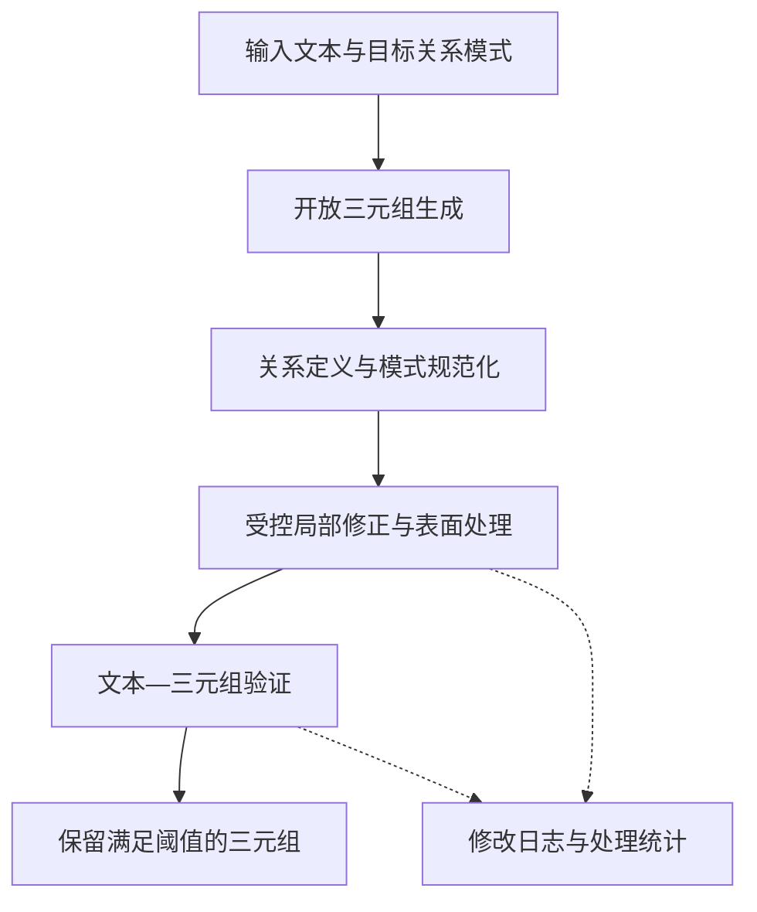

# RCH-TE

**Risk-Controlled Hybrid Triple Extraction**

面向目标关系模式约束的风险受控混合三元组抽取框架。

RCH-TE 将大语言模型的开放三元组生成与判别模型、模式约束和确定性规则结合，从文本中构建关系标签符合目标模式的三元组。框架围绕 **Correct、Keep、Reject** 组织精化决策，通过受约束的实体与关系修正、原预测保留和文本—三元组验证，控制生成结果进入知识图谱的过程。

本项目在 EDC 的开放抽取、关系定义与关系规范化流程上扩展。主入口和部分实现沿用开发阶段的 `BF-EDC`、`BidirectionalFeedbackEDC` 命名。基础方法见 EDC 论文及代码。[论文](https://arxiv.org/abs/2404.03868) · [上游仓库](https://github.com/clear-nus/edc)

## 目录

- [方法概述](#方法概述)
- [代码结构](#代码结构)
- [环境安装](#环境安装)
- [模型配置](#模型配置)
- [数据格式](#数据格式)
- [快速开始](#快速开始)
- [文本—三元组验证](#文本三元组验证)
- [输出与审计](#输出与审计)
- [评估](#评估)
- [实验配置与复现范围](#实验配置与复现范围)
- [致谢与引用](#致谢与引用)
- [许可证](#许可证)

## 方法概述

给定文本和预定义的目标关系集合，RCH-TE 输出由主语、目标关系和宾语组成的三元组列表。框架关注开放关系到目标谓词的映射、实体与字面量的表示，以及完整事实的文本支持程度。

| 环节 | 主要作用 | 对应实现 |
| --- | --- | --- |
| 开放三元组生成 | 使用 LLM 从输入文本提取实体与开放关系 | `edc/extract.py`、`edc/bidirectional_feedback_edc.py` |
| 关系定义与模式规范化 | 生成关系描述，检索目标关系候选，并使用 LLM 判断映射 | `edc/schema_definition.py`、`edc/schema_canonicalization.py` |
| 受控局部修正 | 使用实体对齐器、关系分类器和模式感知重排提出并筛选修改 | `entity_aligner.py`、`relation_classifier.py`、`edc/relation_reranker.py` |
| 确定性输出处理 | 按配置修复表面形式、执行有限关系纠正和去重 | `edc/object_normalizer.py`、`edc/output_postprocessor.py` |
| 文本证据过滤 | 为文本—三元组对评分，按全局或关系级阈值保留候选 | `scripts/rebel/score_rebel_entailment.py`、`scripts/rebel/apply_rebel_entailment_scores.py` |

三个决策承担不同作用。

- **Correct** 在候选空间和适用约束内修正实体表示或目标关系。
- **Keep** 在修改条件不足时保留原预测。关系重排结合候选概率、相对分数优势、模式合法性与上下文条件决定是否替换。
- **Reject** 使用文本—三元组验证分数过滤证据支持不足的候选。

以下展示统一精化协议的概念流程。



主抽取入口内部的关系重排位于关系定义之后、模式规范化之前，实体对齐位于后续处理阶段。离线精化流程可对固定候选执行局部修正，再重新评分和过滤。文本—三元组验证通过独立脚本运行，复现时需显式连接这两个阶段。

## 代码结构

```text
.
├── run_bf_edc.py                   # RCH-TE 主抽取入口，沿用 BF-EDC 命名
├── run.py                          # 基础 EDC 入口
├── edc/
│   ├── bidirectional_feedback_edc.py
│   ├── schema_definition.py
│   ├── schema_canonicalization.py
│   ├── relation_reranker.py
│   ├── output_postprocessor.py
│   ├── object_normalizer.py
│   ├── postprocess_profiles/        # 数据集相关处理配置
│   └── utils/llm_utils.py           # 模型注册表与调用封装
├── entity_aligner.py
├── relation_classifier.py
├── datasets/                       # 逐行输入文本
├── schemas/                        # 目标关系及其描述
├── prompt_templates/
├── few_shot_examples/
├── scripts/
│   ├── webnlg/                     # WebNLG 数据构建与验证器实验
│   ├── rebel/                      # REBEL 数据、验证、过滤与训练工具
│   └── wiki_nre/                   # Wiki-NRE 数据与验证器实验
├── evaluate/                       # 评估器及参考三元组
├── analysis/                       # 实验配置、诊断与来源审计
├── model_api_config.example.json
└── environment.yml
```

## 环境安装

`environment.yml` 保存了 Linux/CUDA 环境快照，包含 Python 3.9、PyTorch 2.2.2、CUDA 12.1、Transformers 4.43.4 和 Sentence Transformers 3.0.1。可在 Linux 或 WSL 中使用 Conda 创建环境。

```bash
conda env create -f environment.yml
conda activate edc
```

准备评估所需的 NLTK 分词资源。

```bash
python -m nltk.downloader punkt punkt_tab
```

该快照包含平台相关包。迁移到其他操作系统或 CUDA 版本时，需要适配相应依赖。运行前还需准备所选嵌入模型，启用实体对齐、关系重排或文本验证时，还需提供相应检查点及资源。

保存的实现审计记录了双 RTX 3090、vLLM 部署的 Qwen2.5-32B-Instruct-AWQ 和 `e5-mistral-7b-instruct` 配置。其他实验的模型版本和量化精度应按各自运行记录确认。[实现审计](analysis/implementation_audit_20261023/report.zh-CN.md)

## 模型配置

主抽取入口读取仓库根目录的 `model_api_config.json`，通过模型别名选择服务。可以参照示例文件创建配置，已有配置时追加所需模型条目。[配置示例](model_api_config.example.json)

下面给出本地 OpenAI-compatible 服务的配置示例。`model` 应与服务实际提供的模型名称一致，`base_url` 应改为实际服务地址。

```json
{
  "models": {
    "qwen_local": {
      "backend": "openai_compatible",
      "model": "qwen2.5-32b-instruct",
      "api_key_env": "LOCAL_LLM_API_KEY",
      "base_url": "http://127.0.0.1:8000/v1"
    }
  }
}
```

在运行抽取命令的终端设置凭据。以下适用于未启用认证的本地服务，启用认证的服务使用实际密钥。

```bash
export LOCAL_LLM_API_KEY=EMPTY
```

Windows PowerShell 对应写法如下。

```powershell
$env:LOCAL_LLM_API_KEY = 'EMPTY'
```

`--cheap_model` 指定开放抽取模型，`--mid_model` 指定关系定义与模式规范化等阶段使用的模型。二者可以使用同一个别名。`--sc_embedder` 接受 Sentence Transformers 模型名称、本地路径或已注册的嵌入模型别名。

## 数据格式

### 输入文本

输入文件使用 UTF-8 编码，每行对应一条待处理文本。

```text
John Doe is a student at National University of Singapore.
```

### 目标关系模式

模式文件使用无表头 CSV，每行包含关系标签和关系描述。描述中含逗号时，按 CSV 规则添加引号。

```csv
student,The subject receives education at the institute specified by the object entity.
country,The subject entity is located in the country specified by the object entity.
```

### 三元组与参考答案

预测和参考文件每行包含一个三元组列表，文件行与输入文本一一对应。空预测使用 `[]`。

```text
[['John Doe', 'student', 'National University of Singapore']]
```

主抽取入口会跳过输入文件中的空白行。准备评估或验证数据时，应保证文本、预测、参考的有效行数及顺序一致。

每组 few-shot 资源需要包含以下文件。

```text
few_shot_examples/<dataset>/
├── oie_few_shot_examples.txt
├── sd_few_shot_examples.txt
├── oie_few_shot_refine_examples.txt
└── ee_few_shot_examples.txt
```

## 快速开始

以下命令均在仓库根目录执行，使用 Bash 的多行续写语法。基础示例使用自带的 `example` 数据，启用最终输出处理。运行前先完成模型配置并准备嵌入模型。

```bash
python run_bf_edc.py \
  --dataset example \
  --cheap_model qwen_local \
  --mid_model qwen_local \
  --sc_embedder intfloat/e5-mistral-7b-instruct \
  --max_feedback_iterations 1 \
  --oie_batch_size 1 \
  --enable_output_postprocess \
  --output_postprocess_profile webnlg_conservative \
  --output_dir output/example_rchte
```

该示例运行开放抽取、模式规范化及已启用的规则处理。要运行包含判别模型与文本证据过滤的配置，继续启用下面的可选模块，并执行下一节的验证步骤。每次运行使用独立输出目录，便于保留配置与中间结果。

### 启用关系重排与实体对齐

准备与目标数据、关系集合匹配的模型检查点后，可向上述抽取命令追加以下参数。将示例路径替换为实际资源路径。

```text
--enable_relation_reranker
--relation_classifier_model /path/to/relation_classifier.pt
--relation_reranker_top_k 5
--relation_reranker_min_prob 0.70
--relation_reranker_margin 0.20
--enable_entity_aligner
--entity_aligner_model /path/to/entity_aligner.pt
--entity_aligner_data_dir /path/to/entity_candidate_data
```

关系重排复用关系分类器的候选概率。实体对齐器的权重与候选池需分别配置。当前候选池构建逻辑会读取指定目录中存在的 `train.json`、`val.json`、`test.json`，训练分区限定的实验应为该目录准备相应范围的资源。启动后核对日志中的模型加载状态与实际启用模块。

### 使用自定义数据

通过以下参数覆盖默认资源位置，并保留所需模型与模块参数。

```text
--dataset my_dataset
--dataset_file /path/to/texts.txt
--schema_file /path/to/schema.csv
--few_shot_dir /path/to/few_shot_examples
--reference_file /path/to/references.txt
--output_dir output/my_dataset_rchte
```

`--reference_file` 用于生成评估命令提示，实际评估需单独执行。输出处理配置通过 `--output_postprocess_profile` 选择，内置配置位于 `edc/postprocess_profiles/`，也支持指定 JSON 路径。

## 文本—三元组验证

验证阶段对每个文本—三元组对计算支持分数，再按阈值保留候选。验证器使用序列分类模型，需准备包含模型和 tokenizer 文件的检查点目录。

下面演示对快速开始输出进行评分与过滤。变量中的模型路径、阈值、输入格式、最大长度和上下文窗口应按对应检查点及开发集选择结果设置。

```bash
CANDIDATES=output/example_rchte/iter0/canon_kg.txt
TEXTS=datasets/example.txt
VERIFIER=/path/to/verifier_checkpoint
THRESHOLD=0.90

python -m scripts.rebel.score_rebel_entailment \
  --raw "$CANDIDATES" \
  --dataset "$TEXTS" \
  --model_dir "$VERIFIER" \
  --output output/example_rchte/verifier_scores.jsonl \
  --max_length 192 \
  --batch_size 32 \
  --structured_input \
  --context_window_chars 0

python -m scripts.rebel.apply_rebel_entailment_scores \
  --raw "$CANDIDATES" \
  --dataset "$TEXTS" \
  --scores output/example_rchte/verifier_scores.jsonl \
  --threshold "$THRESHOLD" \
  --output_dir output/example_rchte_verified
```

示例中的 `0.90` 仅演示参数写法。关系级策略使用 `--threshold_policy /path/to/threshold_policy.json` 替换 `--threshold`。评分和过滤必须使用同一份候选文件，局部修改、去重或重排后应重新评分，并核对行号、候选索引和内容。过滤脚本默认保留缺失评分的候选，完整实验需检查评分覆盖情况和输出摘要。

验证器训练入口为 `scripts/rebel/train_rebel_entailment_verifier.py`。各数据集的数据构建和种子实验说明位于对应脚本目录。[WebNLG](scripts/webnlg/README_verifier_seed_study.zh-CN.md) · [REBEL](scripts/rebel/README_verifier_seed_study.zh-CN.md) · [Wiki-NRE](scripts/wiki_nre/README_verifier_seed_study.zh-CN.md)

## 输出与审计

主抽取结果保存在 `<output_dir>/iter0/`。文件随启用模块和实际决策生成。

| 文件 | 内容与生成条件 |
| --- | --- |
| `canon_kg.txt` | 本次抽取入口的最终三元组 |
| `canon_kg.raw.txt` | 启用最终输出处理时保存的处理前候选，已包含此前阶段的修改 |
| `result_at_each_stage.json` | 输入文本、最终三元组与阶段元数据 |
| `bf_edc_stats.json` | 模块处理统计 |
| `relation_reranker_changes.jsonl` | 存在修改或拒绝决策时保存的关系重排日志 |
| `relation_reranker_summary.json` | 对应关系重排决策摘要 |
| `output_postprocess_changes.jsonl` | 启用最终输出处理时保存的修改日志 |
| `output_postprocess_summary.json` | 对应输出处理摘要 |

离线验证结果写入另一个输出目录，其 `iter0/` 包含过滤后的 `canon_kg.txt`、`entailment_verification_changes.jsonl` 和 `entailment_verification_summary.json`。

## 评估

使用文本对应的参考三元组评估最终预测。

```bash
python evaluate/evaluation_script1.py \
  --edc_output output/example_rchte_verified/iter0/canon_kg.txt \
  --reference evaluate/references/example.txt
```

评估报告默认写入预测文件同目录的 `evaluation_scores.txt`。`evaluation_script1.py` 使用 Hungarian 算法完成三元组对齐，并沿用原评估器的评分逻辑。

项目报告的 **Full F1** 由评估器对小写化后的完整三元组标签计算 label-macro F1。Full precision、recall 和 F1 分别进行宏平均。Partial、Strict 和 Exact 汇总应读取报告的 `Total scores` 区块，主体、谓词和宾语分项单独呈现。比较结果时应统一评估器、输入文本、参考文件及格式处理策略，并为 exact-set micro 等补充指标保留独立名称。

## 实验配置与复现范围

仓库包含 WebNLG、REBEL 和 Wiki-NRE 相关工具，以及多组候选、规则和验证器实验。复现具体论文表格时，需要同时固定数据版本、few-shot 来源、候选文件、检查点、阈值策略、处理顺序和评估器。

- **数据版本**。默认 `datasets/rebel.txt`、`datasets/wiki-nre.txt` 与后续 `official_*` 实验使用的数据资源分别管理，正式实验按运行记录指定完整路径。
- **模块开关**。`--ablation_mode full` 启用该模式的基础增强配置。关系分类器、关系重排、神经实体对齐和最终输出处理各有独立开关，文本验证在离线阶段运行。
- **处理顺序**。统一精化协议采用局部修正后重新评分、再验证的顺序。历史配置还包含验证后处理和仅验证分支，各配置的结果按对应流程解释。
- **训练与选择范围**。已有审计记录了部分历史训练数据重叠、评价数据参与阈值或规则选择，以及训练与评分输入编码约定差异。相关历史结果与训练随机性实验应按记录的适用范围报告。[协议审计](analysis/paper_final_protocol_20261022/answers.zh-CN.md)
- **消融与稳定性**。主入口提供 `--disable_ca_oie`、`--disable_sd_ac`、`--disable_bi_sc`、`--disable_gca` 等开关。固定候选的局部修正与验证四组对照另有脚本，运行方式见相应说明。多个训练种子的结果需使用同一冻结协议汇总。[固定候选对照](scripts/README_dataset_corrections_v3.md)

## 致谢与引用

本项目基于 EDC 进行扩展，保留其开放抽取、关系定义和模式规范化实现基础。使用这些资源时，请同时参考并引用 EDC 的原始工作。[EDC 论文](https://arxiv.org/abs/2404.03868)

```bibtex
@article{zhang2024extract,
  title={Extract, Define, Canonicalize: An LLM-based Framework for Knowledge Graph Construction},
  author={Zhang, Bowen and Soh, Harold},
  journal={arXiv preprint arXiv:2404.03868},
  year={2024}
}
```

## 许可证

仓库根目录包含 MIT 许可证及上游版权声明。使用第三方模型、数据集和对比方法时，请遵循各资源的许可条款。[LICENSE](LICENSE)
